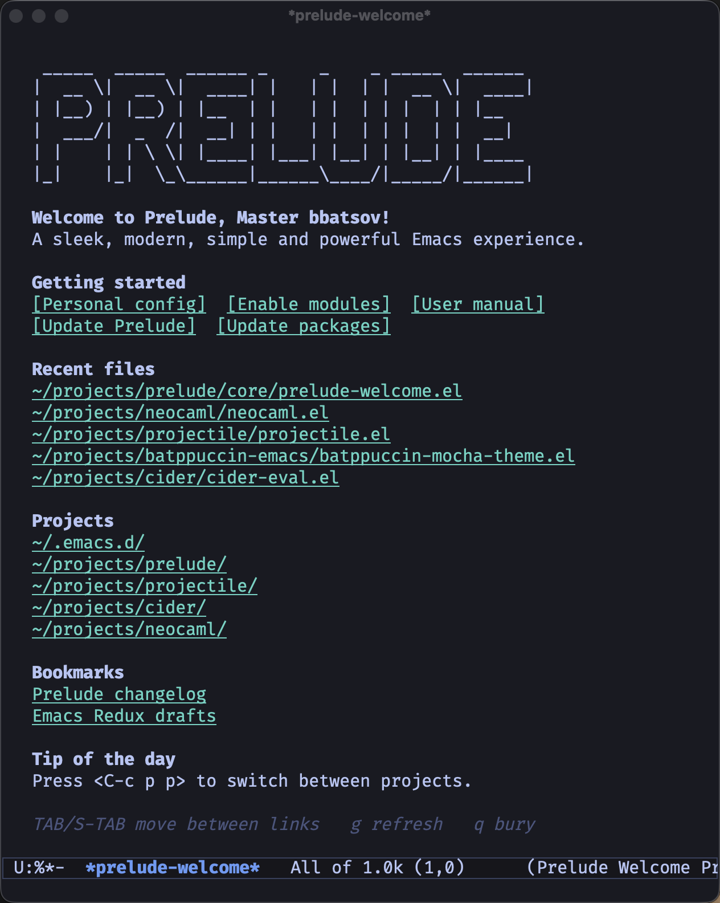
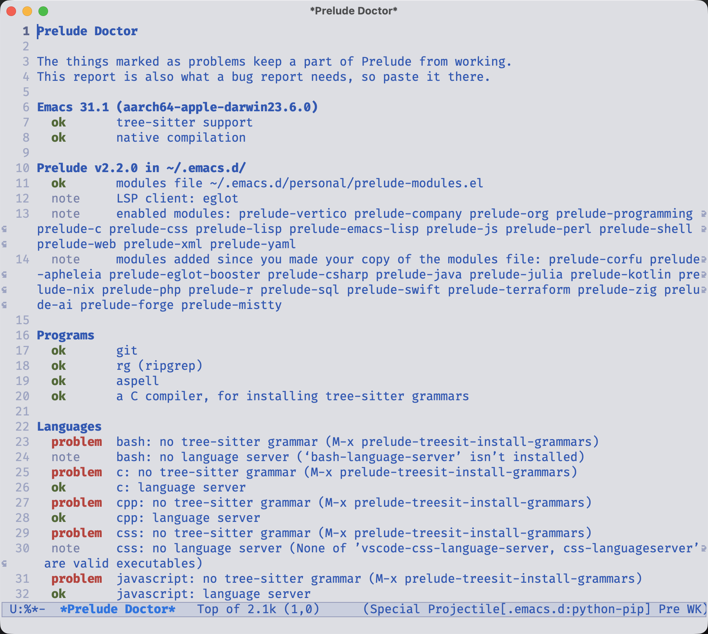
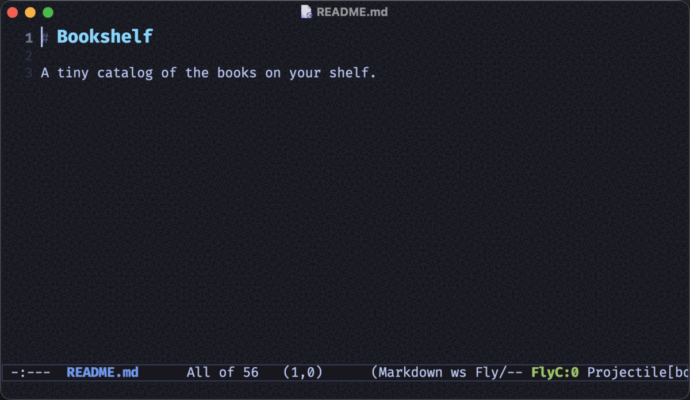

[Emacs Prelude](https://github.com/bbatsov/prelude) [2.2][release] is
out! 2.0 and 2.1 shipped within a few days of each other [back in
March](), while 2.2 took
eight months and about 150 commits. It's a big one!

<!--more-->

## A New Look

Let's start with the most visible change. Zenburn had been Prelude's
default theme since day one, and I still love it (I've been maintaining
its Emacs port for ages, so it's not like we're breaking up). Still, at
some point I got tired of looking at it. These days I'm mostly using
Tokyo Night and Batppuccin (my take on Catppuccin), which I wrote about
[a while ago](),
and I figured it was time to freshen up Prelude's look as well.

[Tokyo Night](https://github.com/bbatsov/tokyo-night-emacs) is the new
default, with its light variant during the day and the dark one at
night. Prelude follows your system's light and dark mode where Emacs
knows about it, and the clock everywhere else (see [automatic light/dark
theme switching]()
for the gory details). If you're a Zenburn fan, keeping it is a one-liner
in `personal/preload`:

``` emacs-lisp
(setq prelude-theme 'zenburn)
```

## What's New

Broadly speaking, this release was about four things:

- internal housekeeping and consistency (every module is now set up the
  same way, the way you'd set things up in your own config)
- modernizing the internals (more of what's built into Emacs these
  days, fewer third-party packages, faster startup)
- covering more of the popular programming languages out of the box
- better defaults for the UI and the overall experience

Here are the changes I'm most excited about.

### A Welcome Screen

Prelude now shows you a welcome screen when you start Emacs
without a file to open. It points newcomers at the basics (your
personal config, the list of enabled modules, the manual) and gives
everyone quick access to their recent files, projects and bookmarks,
plus a tip of the day:



`M-x prelude-welcome` brings it back any time. If that's not your cup
of tea, `(setq prelude-welcome-screen nil)` turns it off.

### M-x prelude-doctor

When something doesn't work, the first question is usually "what's
missing?" `M-x prelude-doctor` answers that for you. It checks the
programs Prelude relies on (`git`, ripgrep, a C compiler for
tree-sitter grammars), the grammars and language servers of the
modules you've enabled, modules that do the same job (e.g. Company and
Corfu), and the obsolete Prelude hooks your config still uses:



It also lists the modules that were added to Prelude since you made your
copy of the modules file, which is a nice way to find out about new
modules. And the report is exactly what a bug report needs, so paste it
there.

### More Languages Out of the Box

Java, C#, Kotlin, PHP, Swift, Julia, R, Nix, SQL, Terraform and Zig got
modules of their own, so Prelude now covers most of the popular
languages out there. More importantly, the experience of opening a file
in a new language got a lot better. Prelude offers to install a missing
tree-sitter grammar the first time you need it (and falls back to the
classic major mode if you say no), and it starts a language server only
if there's one installed, mentioning it once if there isn't. No more
Eglot complaining every time you open a file. Here it is for a Go
project on a fresh install:



`M-x prelude-treesit-install-grammars` installs the grammars of all the
modules you've enabled in one go, if you'd rather get that out of the
way.

### Just Emacs

This one isn't exciting, but it's the change I like the most. Prelude
has always tried not to feel alien to people who know Emacs, yet over
the years the modules picked up Prelude-specific ways of doing things -
`prelude-ruby-mode-hook`, `prelude-ruby-mode-defaults` and the like.
Now every module installs its packages with `use-package` and sets up
its major modes with a named function on the mode's own hooks:

``` emacs-lisp
(add-hook 'ruby-mode-hook #'prelude-ruby-setup -50)
(add-hook 'ruby-ts-mode-hook #'prelude-ruby-setup -50)
```

The depth of -50 means Prelude's setup runs before your own functions on
the same hooks, so your config always has the last word. Want something
extra in Ruby buffers? Add it to `ruby-mode-hook`, like you would without
Prelude. Want Prelude's setup gone? `remove-hook` does the trick. All of
Prelude's options also work from `M-x customize` now, and there's a new
manual page on [writing a module][writing] for those of you who'd like
to contribute one.

### Faster Startup

I still think that [startup time doesn't really
matter](https://batsov.com/articles/2025/04/07/emacs-startup-time-does-not-matter/),
but Prelude now starts in about 0.4 seconds in a terminal with the
default modules (down from 1.3). There's a new `early-init.el` that
tunes startup, packages are no longer initialized twice, the shell
environment is read only for GUI frames and daemons, and a bunch of
things (TRAMP, Eglot, calc, etc) are loaded only when you need them.
You can keep your own early settings in `personal/early-init.el`.

## Odds and Ends

A few more things worth mentioning:

- The Vertico module got [Embark](https://github.com/oantolin/embark)
  (`C-.` and `C-;`), the `vertico-directory` extension and consult's
  narrowing (e.g. `< b` in `consult-buffer` shows only buffers).
- `repeat-mode` and `context-menu-mode` are on by default.
- New optional modules: Corfu (as an alternative to Company), Apheleia
  (async format on save), eglot-booster, Forge, MisTTY and AI (a thin
  wrapper around gptel).
- You can pick [jinx](https://github.com/minad/jinx) as the spell
  checker and [ws-butler](https://github.com/lewang/ws-butler) for
  cleaning up whitespace, if you prefer them to the defaults.
- Prelude installs fewer packages - `browse-kill-ring`,
  `discover-my-major`, `smartrep` and `gist` are gone, as are `which-key`
  and `editorconfig` on Emacs 30+, where they're built in.
- The manual has a new page on [how Prelude differs from stock
  Emacs][differences], which is handy when you're wondering why a key
  doesn't do what you expected.
- Lots and lots of bug fixes (the installer in particular got some
  much needed love).

The [changelog] has the full list.

## Upgrading

Most setups should keep working as they are, but a few things changed:
the theme, a handful of key bindings (e.g. the Go test commands, some
Ivy and Org keys, and `M-y` is Emacs's own `yank-pop` again),
`prelude-require-package` is deprecated in favour of `use-package`, and
the `prelude-*-mode-hook`s are obsolete (they still run, and
`prelude-doctor` will tell you which ones you're using). The [upgrade
notes][upgrading] cover all of that, so give them a quick read before
running `M-x prelude-update`.

## 15 Years Later

Prelude turned 15 this year, and it's in better shape today than it has
been in a very long time. I've got a few more ideas for 2.3, and I hope
it won't take eight months this time.[^1] As always, thanks to everyone
who reported problems, sent patches and kept using Prelude over the
years! You rock!

That's all I have for you today. Keep hacking!

[^1]: Famous last words.

[release]: https://github.com/bbatsov/prelude/releases/tag/v2.2.0
[changelog]: https://github.com/bbatsov/prelude/blob/master/CHANGELOG.md#220-2026-11-25
[upgrading]: https://prelude.emacsredux.com/en/latest/upgrading/
[writing]: https://prelude.emacsredux.com/en/latest/modules/writing/
[differences]: https://prelude.emacsredux.com/en/latest/differences/
