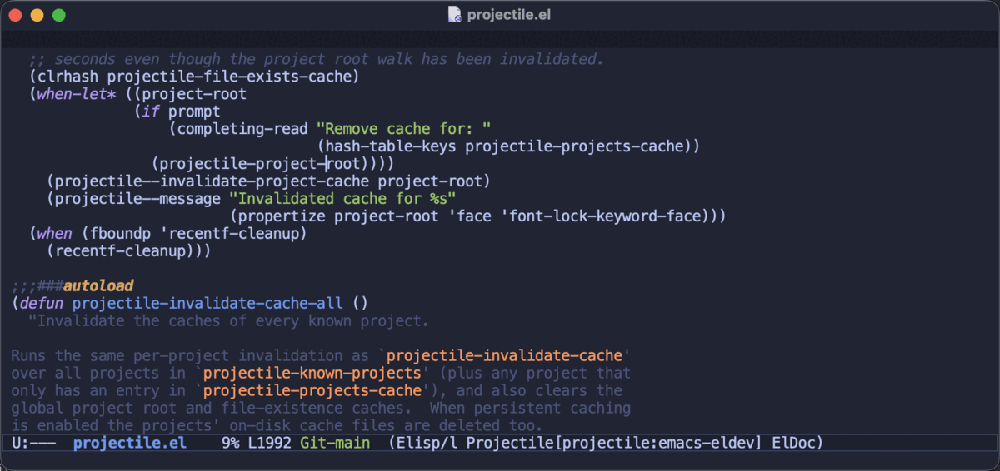
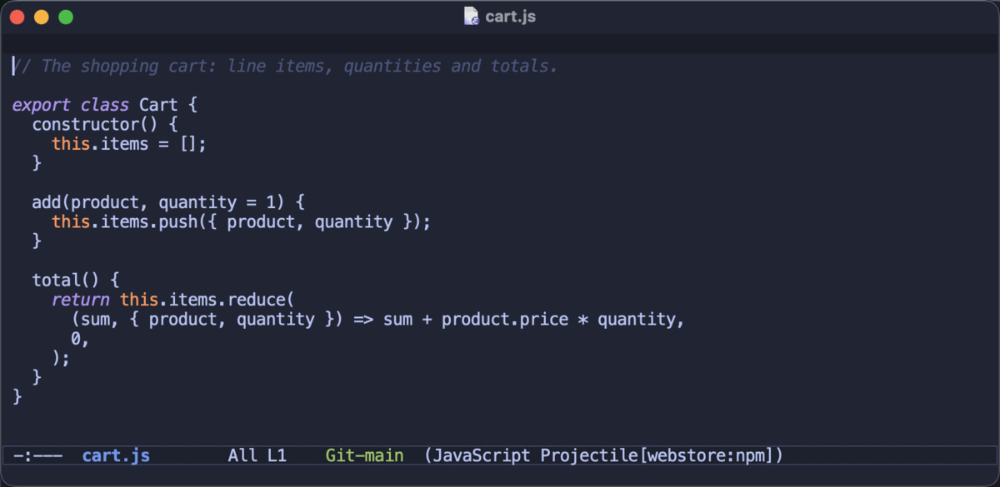
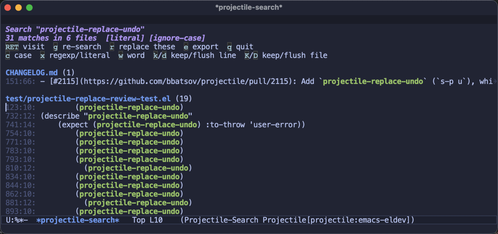

[Projectile](https://github.com/bbatsov/projectile) asks you a lot of questions.
What do you want to search for? Replace it with what? Which command should I
run? For as long as I can remember those prompts were about as dumb as a prompt
can be - an empty line, maybe with the symbol at point as the default, and
you had to type the rest.

That's a bit silly when you think about it, because by the time Projectile asks
you something it already knows quite a lot - the project you're in, the function
your cursor is sitting in, the `Makefile` at the root of the project and what's
in it. I've been meaning to do something about this for ages, and in the
upcoming Projectile 3.5 a bunch of prompts finally start to use that knowledge.
Let's go over them!

## The Search Prompt

Every command that asks what to search for (`projectile-search`,
`projectile-grep`, `projectile-ripgrep`, the search reviewer,
`projectile-find-references` and friends) now uses the same prompt. It's still a
plain text prompt, so whatever you type is what gets searched for, but it has
learned a few new tricks:

- `RET` on an empty prompt searches for the symbol at point (or the region), as before
- `M-n` goes through a few more guesses - the name of the function you're in,
  the name of the current file and the last thing you looked for with Isearch
- `M-p` goes through your previous searches, and the search prompts now have a
  history of their own
- `TAB` completes the word before point against the identifiers that occur in the project (super handy)

Here's all of this in action:



The `TAB` completion is my favorite part. I can never remember whether something
was named `projectile-replace-review` or `projectile-review-replace`, and now I
don't have to! The candidates are sorted by how often they show up in the
project, so the names you actually use end up at the top.

Where do the candidates come from? There's no index and no tags file involved.
Projectile just runs `rg` (or `git grep`, if you don't have ripgrep installed)
for the prefix you've typed and collects the words that start with it. That
takes a few milliseconds on a small project and a fraction of a second on
something as big as Emacs itself. Not too shabby, right? You need to type at
least two characters for the completion to kick in. And if you don't like it,
you can always turn it off:

``` emacs-lisp
(setq projectile-search-complete-identifiers nil)
```

**Note:** You might be wondering why the prompt isn't simply using
`completing-read`. That would have been the easiest way to get completion, but
with something like Vertico pressing `RET` would then select the current
candidate instead of what you've typed, and I really don't want a search prompt
that second-guesses my input. That's why it's a plain `read-from-minibuffer` with a
`completion-at-point` function installed in it, so `TAB` works the same way it
does in a code buffer. In the screencast above the candidates are displayed by
`consult-completion-in-region`. Without it you'll get the stock `*Completions*`
buffer.

## The Replace Prompts

`projectile-replace` reads what to replace with the same prompt, so everything
above applies there as well. When it asks what to replace it _with_, `M-n`
brings up the original text. After all, most replacements are a small edit of
the thing they replace (e.g. a rename), so it's nice not to have to type it
again.

With a prefix argument the search and replace commands ask which files to work
on, and those prompts now complete over the file extensions that are actually
present in the project. (the most common ones come first)

## The Command Prompts

The compile, test and run prompts got the same treatment. `M-p` has always gone
through the commands you've run before. Now `M-n` goes the other way - through
commands you haven't run yet, but the project suggests - the default command for
the project's type, followed by the commands of its
[tasks](https://docs.projectile.mx/projectile/tasks.html) (Make targets, npm
scripts, just recipes and so on). The tasks named after what you're doing come
first, so the test prompt starts with things like `make test`:



The same suggestions show up on `M-n` when you run a shell command in the
project root with `s-p !` or `s-p &`.

## Filtering Search Results

Projectile's search and replace results buffers have had filters for a while -
`k`/`d` to keep or flush matches by line, and `K`/`D` to do the same by file.
The file filters expect a regular expression and most of the time people type
pretty much the same thing there - something like `^test/`.

Now the prompt suggests it for you. The default is the directory of the match at point,
and `M-n` goes on to that file's extension, the file itself and then the
top-level directories that have matches, busiest first. Getting rid of all the
matches in the tests is `D RET`:



## Odds and Ends

- `C-u s-p C` (`projectile-find-changed-file` with a prefix argument) asks for a
  revision to compare against. It now defaults to the project's main branch,
  whatever it happens to be called, and it completes over tags as well, so
  "what changed since the last release" is a `M-n` or two away.
- `projectile-add-known-project` starts at the root of the project you're in,
  instead of whatever subdirectory the current buffer lives in.

## M-n is Underrated

You've probably noticed that `M-n` shows up in pretty much every section of
this article. Every Emacs user knows that `M-p` in the minibuffer goes back
through the history. I'm not sure how many people know that `M-n` goes
_forward_, into what the Emacs manual calls "future history" - a list of
guesses that the command has made about what you might want to type. A lot of
built-in commands provide those (try `M-n` at the `query-replace` or `find-file`
prompts), but you'll never see them unless you ask, so they are easy to miss.
It's one of those fairly obscure Emacs features that really deserve to be
better known.

For package authors that's probably the cheapest way to make a prompt smarter.
The functions that read from the minibuffer (`read-string`,
`read-from-minibuffer`, `completing-read`, `read-shell-command`) all accept a
list as their default value, and that list is what `M-n` goes through:

``` emacs-lisp
(read-string "Search for: " nil 'my-search-history
             (delq nil
                   (list (thing-at-point 'symbol t)
                         (add-log-current-defun)
                         (and buffer-file-name
                              (file-name-base buffer-file-name)))))
```

It doesn't get in anyone's way, it works with every completion framework, and
it's only a few lines of code. I plan to write a bit more about `M-n` soon, as
it certainly deserves an article of its own.

## Closing Thoughts

None of those changes is a big deal on its own, but together they make
Projectile feel a lot smarter to me. All of this will be a part of Projectile
3.5, and most of it is already available in the `master` branch if you want to
play with it today. If you can think of other prompts that could do a better job
of guessing what you want - I'd love to hear about them!

That's all I have for you today. Keep hacking!
